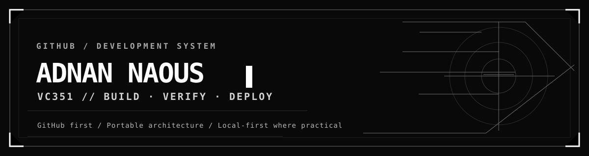

# Adnan Naous · VC351

**Computer Science student · Software projects · AI systems · Local-first tools**

Building, documenting, and improving software. Public projects and verifiable learning — without inflated expertise claims.

[Selected work](#selected-work) · [Workflow](#workflow) · [Learning](#learning) · [Linktree](https://linktr.ee/VC351)

---

## Selected work

| Project | Focus |
| --- | --- |
| [SMART AGENT](https://github.com/AdnanNaous/smart-agent) | Portable AI-agent skill and engineering workflow references. |
| [CS Work Hub](https://github.com/AdnanNaous/cs-work-hub-downloads) | Local-first VS Code dashboard, project creator, and distribution. |
| [CS Learning Journey](https://github.com/AdnanNaous/Adnan-Naous-Journey) | Study records, coding experiments, practice, and corrections. |
| [Windows Maintenance Toolkit](https://github.com/AdnanNaous/Ultimate-Windows-Maintenance) | Windows utilities and scripts; review before execution. |

## Workflow

**Device** → development environment  
**Notion** → private knowledge and project planning  
**GitHub** → canonical code, version history, CI/CD, releases  
**AI** → Codex · Claude Code · local agents, with reviewed changes  
**Browser** → Chrome-based workspace and deployed applications

**GitHub first → local development and tests → replaceable deployment (currently Cloudflare).**

## Learning

Java · Python · Computer Science · Software Engineering · Web Development · AI/ML

Learning interests are not skill-level claims.

## Engineering standards

Private data and credentials stay out of public repositories. Provider-specific APIs belong behind adapters. Changes should be testable, reversible, and accurately documented. Important user data needs independent backups, not just Git history.

[GitHub](https://github.com/AdnanNaous) · [Linktree](https://linktr.ee/VC351)

