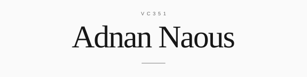

<picture>
  <source media="(prefers-reduced-motion: reduce)" srcset="assets/identity-static.svg">
  
</picture>

# Adnan Naous · VC351

**Computer Science student · Software development · AI and agent systems**

I build software to learn, explore how AI agents can assist engineering, and work on local-first applications. I keep code, decisions and progress reviewable through a GitHub-first workflow.

[Website](https://adnannaous.vercel.app/) · [Linktree](https://linktr.ee/VC351) · [Learning journey](https://github.com/AdnanNaous/Adnan-Naous-Journey)

## Selected projects

| Project | What you will find |
| --- | --- |
| [SMART AGENT](https://github.com/AdnanNaous/smart-agent) | A portable AI-agent skill, engineering references and validation tools. |
| [CS Work Hub](https://github.com/AdnanNaous/cs-work-hub-downloads) | Public downloads and installation guidance for a local-first VS Code dashboard. |
| [Learning Journey](https://github.com/AdnanNaous/Adnan-Naous-Journey) | Computer science notes, experiments, practice and corrections. |
| [Windows Maintenance](https://github.com/AdnanNaous/Ultimate-Windows-Maintenance) | PowerShell diagnostics and maintenance scripts for Windows 11. Review before running. |

## How I work

**GitHub First → Develop → Test → Review → Deploy Anywhere**

| Tool | Role |
| --- | --- |
| Device + VS Code | Local development and execution |
| GitHub | Canonical code, version control, reviews and project documentation |
| Notion | Knowledge, research and planning |
| AI | Engineering assistance with Codex, Claude Code and local agents |
| Chrome | Web access and workspace |
| Cloudflare | Preferred hosting and infrastructure for future deployments |

Security, independent backups and portability cross every layer. I aim for simple infrastructure and replaceable hosting providers.

## Currently learning

Java · Python · Computer science fundamentals · Software engineering · Web development · AI and agent systems

These are learning interests, not claims of expertise.

About the visual

The SVG assets live in this repository and use system monospace fonts. The line animation is decorative, has no flashing, and respects reduced motion where supported. All information is available as text above. [Open the static version](assets/identity-static.svg).

